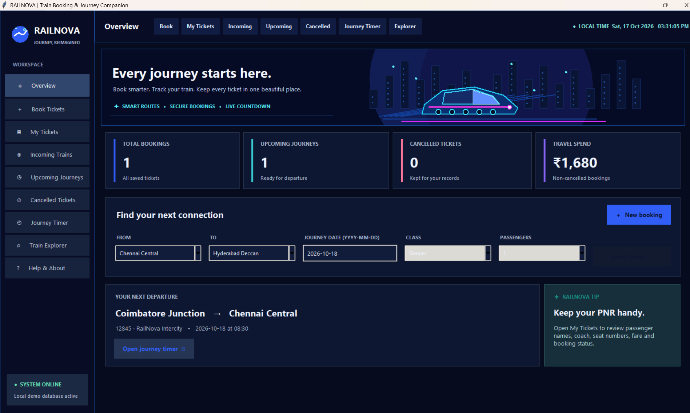
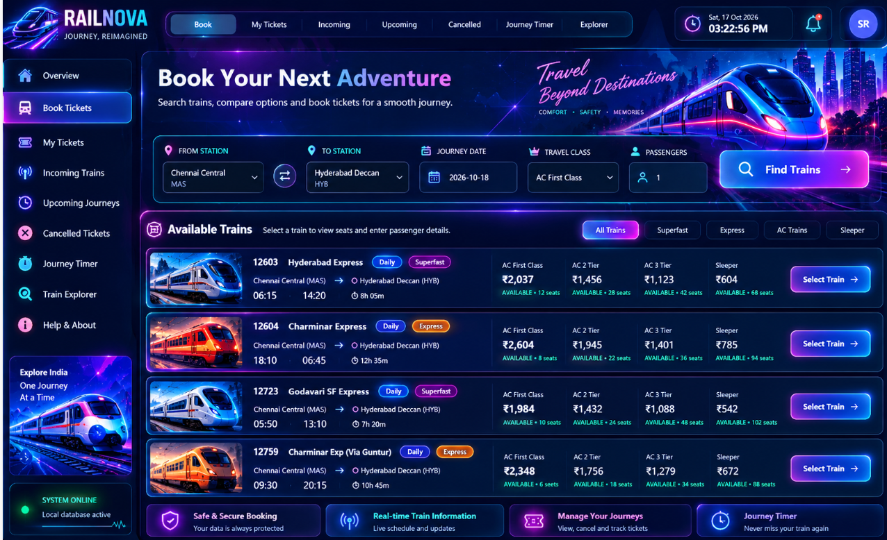
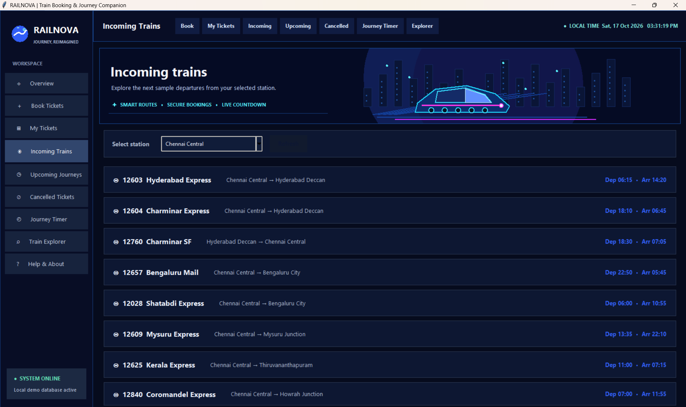
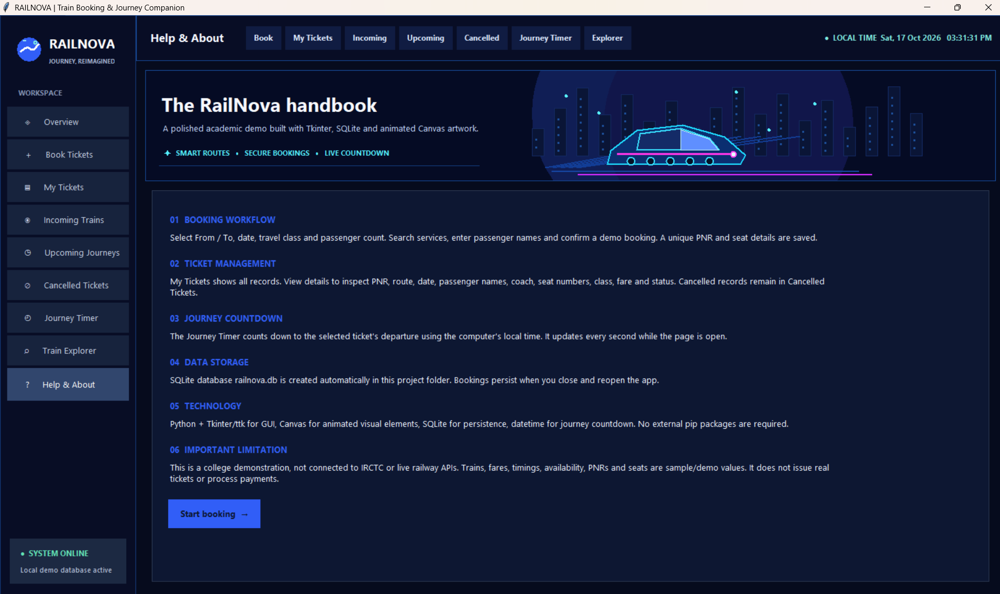

<div align="center">

# 🚆 RAILNOVA
### Train Booking & Journey Companion

**Journey, reimagined.**

A neon-inspired desktop train booking and journey companion built with **Python, Tkinter, and SQLite**.


</div>

---

## ✨ Project Overview

RailNova is a desktop GUI project for exploring sample train services, creating demo bookings, managing saved ticket records, reviewing station-based sample departures, and tracking time until a selected journey. The interface uses a dark midnight palette with neon cyan and magenta highlights.

## 🌌 Features

| Module | Highlights |
|---|---|
| Overview Dashboard | Booking summaries, upcoming trip and quick route search |
| Book Tickets | From/To, journey date, class, passenger count, sample trains and estimated fare |
| My Tickets | Demo PNR, passenger names, route, coach/seat labels, class, fare and status |
| Incoming Trains | Sample services and station-based departure/arrival information |
| Upcoming Journeys | Upcoming saved demo bookings |
| Cancelled Tickets | Separate cancelled-booking history |
| Journey Timer | Countdown updated every second using local system time |
| Train Explorer | Filter sample timetable by train number, name, origin, destination or service type |
| Help & About | Project workflow, stack and limitations |

## 🧰 Technology Stack

- **Python 3** — application logic
- **Tkinter / ttk** — widgets, forms, navigation, tables and dialogs
- **Tkinter Canvas** — drawn UI art and animated accents
- **SQLite** — local booking persistence
- **datetime** — journey date validation and countdown calculations

No third-party `pip` packages are required. Use a Python installation that includes Tkinter.

## 🚀 Run Locally

1. Clone or download this repository.
2. Open the repository folder in VS Code or a terminal.
3. Run:

   ```bash
   py main.py
   ```

   If `py` is unavailable, try `python main.py`.

The app creates `railnova.db` locally. This database is intentionally excluded from version control.

## 🖼️ Application Screenshots

### Overview Dashboard


### Booking / Train Search


### Incoming Trains


### Help & About


## 📊 Project Presentation

The 10-slide PowerPoint presentation is included at [`presentation/RailNova_Personalized_10_Slides.pptx`](presentation/RailNova_Personalized_10_Slides.pptx). It covers the overview, application UI, booking workflow, ticket management, timer, explorer, technology stack and conclusion.

## 🎓 Academic Project

- **Project:** RailNova — Train Booking & Journey Companion
- **Prepared by:** G Suresh Reddy
- **Program:** B.Tech — CSE (Cybersecurity)
- **Course context:** Advanced Programming Practice — Tkinter project

## ⚠️ Demo Limitations

RailNova is an educational prototype, not a live railway reservation service. It is **not connected to IRCTC or a live railway API**. Train timings, availability, fares, PNRs, coach and seat assignments are sample data. No real ticket is issued and no payment is processed.

## 🔭 Future Scope

- Authorized live railway information API integration
- User profiles and authentication
- Verified live schedules and availability
- Secure payment integration for a production system
- Notifications and printable ticket exports

---

<div align="center">

**RAILNOVA** · *Journey, Reimagined* ✦

</div>
